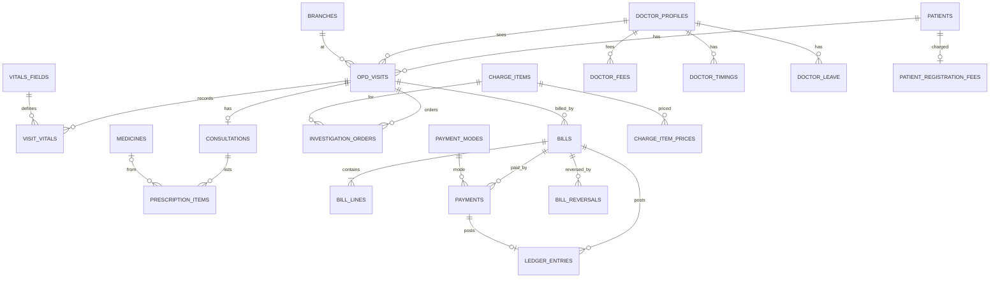

# OPD schema design (release 1)

Status: DRAFT v1 for review, 14 Nov 2026. Author: Rakshith. Input: `docs/use-cases-opd.md` (v2).

Scope: the database design for the OPD block. **Names of existing tables (hospitals, branches, users, patients, audit_logs) are taken from the Phase 1 inspection and must be checked against `schema.prisma` by a read-only inspection before the build.** All other names are proposals.

---

## 1. Conventions (apply to every table below)

| Rule                | Detail                                                                                                                                                                             |
| ------------------- | ---------------------------------------------------------------------------------------------------------------------------------------------------------------------------------- |
| Ids                 | `id` text (cuid), same style as the existing tables                                                                                                                                |
| Tenant              | `tenant_id` text NOT NULL on every table; **FORCE row level security** with the same policy as other tenant tables; no table ships without RLS                                     |
| Branch              | `branch_id` on branch-scoped tables (visits, bills, payments, counters)                                                                                                            |
| Time                | `timestamptz(3)`, stored in UTC. Rule dates (`visit_date`, `token_date`) are IST calendar dates computed in the service from the hospital time zone setting (default Asia/Kolkata) |
| Money               | integer **paise**, `CHECK (amount >= 0)`. Report sums use bigint. Never floats                                                                                                     |
| Codes               | Every master has a `code` that is unique per hospital `(tenant_id, code)`. This is the key Excel re-upload matches on                                                              |
| Delete              | No hard delete anywhere. Masters have `active`. Money, ledger, bill lines, payments and price history are **append-only** (blocked at database level)                              |
| Snapshots           | Anything printed on a document copies the name, code and unit at the time (`*_snapshot`) so later renames or price changes never alter history                                     |
| Cross-tenant safety | Foreign keys include the tenant: parents get `UNIQUE (tenant_id, id)` and children reference `(tenant_id, parent_id)` so a row can never point into another hospital               |
| Audit               | Existing `audit_logs`; every create, approval and reversal logs who, when and what                                                                                                 |
| Roles               | Tables are granted to `hospigo_app` only. `hospigo_hq` and `hospigo_patient` get nothing                                                                                           |

## 2. Entity diagram

Groups: **masters and settings** (section 3), **counters** (4), **visit and clinical** (5), **money** (6).

## 3. Masters and settings (Excel-synced, codes unique per hospital)

### doctor_profiles

| Column          | Type    | Rule                                                            |
| --------------- | ------- | --------------------------------------------------------------- |
| user_id         | text    | the staff account; `UNIQUE (tenant_id, user_id)`                |
| code            | text    | unique per hospital                                             |
| department      | text    | optional                                                        |
| availability_on | boolean | the Admin's switch; default true. Off means "Not Available Now" |
| active          | boolean |                                                                 |

A doctor works across branches. "Not Available Now" = switch off, or on leave today.

### doctor_timings and doctor_leave

| Table          | Columns                                                           | Rule                                              |
| -------------- | ----------------------------------------------------------------- | ------------------------------------------------- |
| doctor_timings | doctor_profile_id, branch_id, weekday (0-6), start_time, end_time | warn only when a visit is created outside timings |
| doctor_leave   | doctor_profile_id, from_date, to_date, reason                     | `CHECK (to_date >= from_date)`                    |

### charge_items and charge_item_prices

| Column                            | Type        | Rule                                                                  |
| --------------------------------- | ----------- | --------------------------------------------------------------------- |
| charge_items.code, name           | text        | unique code per hospital                                              |
| charge_items.kind                 | enum        | CONSULTATION, REGISTRATION, INVESTIGATION                             |
| charge_items.taxable              | boolean     | default false                                                         |
| charge_items.tax_rate_bp          | int         | basis points (1800 = 18 percent); default 0; used only when tax is on |
| charge_items.active               | boolean     |                                                                       |
| charge_item_prices.charge_item_id | text        | FK                                                                    |
| charge_item_prices.amount_paise   | int         | `>= 0`                                                                |
| charge_item_prices.effective_from | timestamptz | `UNIQUE (tenant_id, charge_item_id, effective_from)`                  |
| charge_item_prices.created_by     | text        | only Admin/SuperAdmin (permission)                                    |

**Prices are versioned.** A change inserts a new row; the price in force is the latest row with `effective_from <= now`. Rows are append-only. Registration and investigation prices live here.

### doctor_fees

| Column            | Type        | Rule                                                                             |
| ----------------- | ----------- | -------------------------------------------------------------------------------- |
| doctor_profile_id | text        | FK                                                                               |
| visit_type        | enum        | NEW, FOLLOW_UP                                                                   |
| amount_paise      | int         | `>= 0`                                                                           |
| effective_from    | timestamptz | `UNIQUE (tenant_id, doctor_profile_id, visit_type, effective_from)`; append-only |

### medicines, vitals_fields, payment_modes

| Table         | Columns                                                                                  | Notes                                                                       |
| ------------- | ---------------------------------------------------------------------------------------- | --------------------------------------------------------------------------- |
| medicines     | code, name, composition, form, active                                                    | Excel-synced; doctors may also type free text (flagged unlisted)            |
| vitals_fields | code, name, unit, value_kind (NUMBER or TEXT), display_order, warn_min, warn_max, active | blood pressure is two NUMBER fields (systolic, diastolic); ranges only warn |
| payment_modes | code, name, requires_reference, active                                                   | seeded CASH, UPI, CARD; reference number required when `requires_reference` |

### opd_settings (one row per hospital)

| Column                        | Default      | Used for                           |
| ----------------------------- | ------------ | ---------------------------------- |
| follow_up_free_days           | 7            | free follow-up window              |
| token_prefix                  | `T`          | token label                        |
| timezone                      | Asia/Kolkata | rule dates and token day           |
| tax_enabled                   | false        | tax on bills                       |
| tax_name, tax_registration_no | null         | printed on receipts                |
| tax_inclusive                 | false        | price includes tax or tax is added |

### number_series_settings

| Column         | Type  | Rule                                                                                               |
| -------------- | ----- | -------------------------------------------------------------------------------------------------- |
| series         | enum  | BILL, RECEIPT, REFUND (UHID already has its own format builder)                                    |
| format         | jsonb | building blocks like the UHID builder: fixed text, financial year, separator, running number width |
| reset_rule     | enum  | YEARLY (financial year) or NEVER                                                                   |
| fy_start_month | int   | 1-12; default 4                                                                                    |

`UNIQUE (tenant_id, series)`.

### print_templates

| Column    | Type      | Rule                                                                       |
| --------- | --------- | -------------------------------------------------------------------------- |
| branch_id | text null | null means the whole hospital                                              |
| doc_type  | enum      | REGISTRATION_SLIP, RECEIPT, PRESCRIPTION                                   |
| enabled   | boolean   | the slip can be off completely                                             |
| paper     | enum      | A4, A5, A6, LABEL, CUSTOM; `width_mm`, `height_mm`, `orientation`, margins |
| mode      | enum      | FULL or PREPRINTED                                                         |
| layout    | jsonb     | field visibility, font size, offsets in mm; validated in code              |

One active template per `(tenant_id, branch_id, doc_type)`.

## 4. Counters (gap-free, safe under simultaneous use)

| Table          | Key                                   | Columns         |
| -------------- | ------------------------------------- | --------------- |
| number_series  | `(tenant_id, series, financial_year)` | last_number int |
| token_counters | `(tenant_id, branch_id, token_date)`  | last_token int  |

The next number is taken **inside the same transaction as the row that uses it**, with a row lock (the same approach as the UHID counter). A rolled-back transaction leaves no gap. Bill and receipt numbers are hospital-wide; tokens are per branch per IST day, **one series across all doctors**.

## 5. Visit and clinical

### opd_visits

| Column                                       | Type             | Rule                                                             |
| -------------------------------------------- | ---------------- | ---------------------------------------------------------------- |
| branch_id, patient_id, doctor_profile_id     | text             | FKs (with tenant)                                                |
| visit_type                                   | enum             | NEW, FOLLOW_UP                                                   |
| visit_date                                   | date             | IST date; used by the follow-up window                           |
| status                                       | enum             | AWAITING_PAYMENT, WAITING, IN_CONSULTATION, COMPLETED, CANCELLED |
| is_emergency                                 | boolean          | default false                                                    |
| emergency_reason                             | text null        | `CHECK (NOT is_emergency OR emergency_reason IS NOT NULL)`       |
| previous_visit_id                            | text null        | follow-up link                                                   |
| token_date, token_no                         | date, int        | null until the visit enters the queue                            |
| queued_at                                    | timestamptz null | queue order (payment time, or emergency time)                    |
| consultation_started_at                      | timestamptz null | **a refund is refused once this is set**                         |
| completed_at, cancelled_at, cancelled_reason |                  |                                                                  |
| created_by                                   | text             |                                                                  |

Constraints: `UNIQUE (tenant_id, branch_id, token_date, token_no)` where `token_no` is not null; `CHECK (status = 'AWAITING_PAYMENT' OR token_no IS NOT NULL)`.
Indexes: doctor queue `(tenant_id, branch_id, doctor_profile_id, status, queued_at)`; follow-up lookup `(tenant_id, patient_id, doctor_profile_id, visit_date DESC)`; patient history `(tenant_id, patient_id, created_at DESC)`.

A visit enters the queue (status WAITING, token issued) when its consultation bill is **PAID**, **PART_PAID by exception**, **zero total** (free follow-up), or the visit is **Emergency**.

### visit_vitals

| Column                                      | Type | Rule                                                                   |
| ------------------------------------------- | ---- | ---------------------------------------------------------------------- |
| visit_id, vitals_field_id                   | text | FKs                                                                    |
| name_snapshot, unit_snapshot                | text |                                                                        |
| value_number numeric(10,2), value_text text |      | one of them, by `value_kind`                                           |
| version int, superseded_at                  |      | a correction inserts version+1 and sets `superseded_at` on the old row |
| recorded_by, recorded_at                    |      |                                                                        |

Partial unique index `(tenant_id, visit_id, vitals_field_id) WHERE superseded_at IS NULL` gives exactly one current value.

### consultations and prescription_items

| Table              | Columns                                                                                                                                        | Rule                                          |
| ------------------ | ---------------------------------------------------------------------------------------------------------------------------------------------- | --------------------------------------------- |
| consultations      | visit_id (unique), doctor_user_id, complaints, diagnosis, advice, follow_up_on date, completed_at                                              | one per visit                                 |
| prescription_items | consultation_id, line_no, medicine_id null, medicine_name_snapshot, composition_snapshot, is_unlisted, dose, frequency, duration, instructions | `CHECK (is_unlisted = (medicine_id IS NULL))` |

### investigation_orders

| Column                              | Type      | Rule                                  |
| ----------------------------------- | --------- | ------------------------------------- |
| visit_id, branch_id, charge_item_id | text      | FKs                                   |
| name_snapshot                       | text      |                                       |
| status                              | enum      | ORDERED, BILLED, NOT_TAKEN, CANCELLED |
| not_taken_reason                    | text null | required when NOT_TAKEN               |
| bill_line_id                        | text null | set when billed; one line per order   |
| ordered_by, ordered_at              |           |                                       |

Index for the reception list: `(tenant_id, branch_id, ordered_at) WHERE status = 'ORDERED'`.

## 6. Money (three parts that never mix)

**Bills** say what is owed. **Payments** say what was paid. The **ledger** is the append-only record of every money movement. The amount due is always calculated, never typed.

### bills

| Column                                 | Type        | Rule                                                                                         |
| -------------------------------------- | ----------- | -------------------------------------------------------------------------------------------- |
| branch_id, visit_id                    | text        |                                                                                              |
| bill_type                              | enum        | CONSULTATION, INVESTIGATION                                                                  |
| bill_number                            | text        | from BILL series; `UNIQUE (tenant_id, bill_number)`                                          |
| bill_date                              | timestamptz |                                                                                              |
| subtotal_paise, tax_paise, total_paise | int         | `CHECK (total_paise = subtotal_paise + tax_paise)`                                           |
| paid_paise, refunded_paise             | int         | **maintained only by triggers from the ledger**; the app role has no UPDATE on these columns |
| payment_status                         | enum        | UNPAID, PART_PAID, PAID; trigger-maintained                                                  |
| idempotency_key                        | text        | `UNIQUE (tenant_id, idempotency_key)`: a repeated submit returns the same bill               |
| created_by                             | text        |                                                                                              |

Constraints: `CHECK (paid_paise <= total_paise)` (payments can never exceed the bill); `CHECK (refunded_paise <= paid_paise)`; one consultation bill per visit: `UNIQUE (tenant_id, visit_id) WHERE bill_type = 'CONSULTATION'`.
Indexes: `(tenant_id, branch_id, bill_date)`; pending dues `(tenant_id, branch_id, payment_status) WHERE payment_status <> 'PAID'`.

### bill_lines (append-only)

| Column                              | Type      | Rule                                      |
| ----------------------------------- | --------- | ----------------------------------------- |
| bill_id, line_no                    |           |                                           |
| kind                                | enum      | CONSULTATION, REGISTRATION, INVESTIGATION |
| charge_item_id, doctor_fee_id       | text null | the price source                          |
| code_snapshot, description_snapshot | text      |                                           |
| quantity                            | int       | default 1                                 |
| unit_price_paise                    | int       | the price **at that moment**              |
| tax_rate_bp, tax_paise              | int       | 0 when tax is off                         |
| line_total_paise                    | int       |                                           |
| pricing_note                        | text null | e.g. FOLLOW_UP_FREE_WINDOW                |
| investigation_order_id              | text null |                                           |

### payments (append-only)

| Column               | Type      | Rule                                                                                                          |
| -------------------- | --------- | ------------------------------------------------------------------------------------------------------------- |
| bill_id, branch_id   | text      |                                                                                                               |
| receipt_number       | text      | from RECEIPT series; unique per hospital                                                                      |
| payment_mode_id      | text      |                                                                                                               |
| amount_paise         | int       | `> 0`                                                                                                         |
| reference_no         | text null | required when the mode requires it                                                                            |
| partial_reason       | text null | required when the bill is still unpaid after this payment (the part-payment exception, permission-controlled) |
| paid_at, received_by |           |                                                                                                               |
| idempotency_key      | text      | `UNIQUE (tenant_id, idempotency_key)`: a double click never charges twice                                     |

### ledger_entries (append-only)

| Column                  | Type        | Rule                                          |
| ----------------------- | ----------- | --------------------------------------------- |
| bill_id, branch_id      | text        |                                               |
| entry_type              | enum        | CHARGE, PAYMENT, REFUND, CHARGE_REVERSAL      |
| amount_paise            | int         | `> 0`; the effect is defined by `entry_type`  |
| payment_id, reversal_id | text null   | link to the source row; `UNIQUE (payment_id)` |
| posted_at               | timestamptz |                                               |

Every bill, payment, refund and reversal inserts exactly one ledger row **in the same transaction**. Triggers update `bills.paid_paise`, `refunded_paise` and `payment_status` from these rows. Balance of a bill = CHARGE - CHARGE_REVERSAL - (PAYMENT - REFUND). A view `bill_balances` exposes it.

### bill_reversals (refunds and cancellations)

| Column                                   | Type | Rule                                                                                          |
| ---------------------------------------- | ---- | --------------------------------------------------------------------------------------------- |
| bill_id, branch_id                       | text |                                                                                               |
| kind                                     | enum | VISIT_CANCEL, LINE_NOT_TAKEN, WRONG_BILL                                                      |
| reason                                   | text | required                                                                                      |
| status                                   | enum | REQUESTED, APPROVED, REJECTED                                                                 |
| requested_by, requested_at               |      |                                                                                               |
| decided_by, decided_at, decision_note    |      | approver needs the refund-approve permission; **default: not the same user as the requester** |
| refund_amount_paise                      | int  | `<= paid_paise - refunded_paise`                                                              |
| refund_payment_mode_id, refund_reference |      | refunds follow the original mode                                                              |
| refund_number                            | text | from REFUND series on execution                                                               |
| idempotency_key                          | text | unique per hospital                                                                           |

Rule: a reversal on a consultation bill is **refused when the visit has `consultation_started_at` set**. Enforced in the service and by a database check, and tested.

### patient_registration_fees

| Column       | Type             | Rule                         |
| ------------ | ---------------- | ---------------------------- |
| patient_id   | text             |                              |
| bill_line_id | text             |                              |
| charged_at   | timestamptz      |                              |
| voided_at    | timestamptz null | set if that bill is reversed |

Partial unique index `(tenant_id, patient_id) WHERE voided_at IS NULL` makes the registration fee **once per patient across all branches**, guaranteed by the database. UNCONFIRMED: when the bill is reversed the patient is charged again on the next visit.

## 7. Append-only protection (same idea as the audit log)

Triggers block UPDATE and DELETE on: `ledger_entries`, `payments`, `bill_lines`, `charge_item_prices`, `doctor_fees`. `bills` may change only the three trigger-maintained columns. `visit_vitals` may change only `superseded_at`. `hospigo_app` is granted INSERT and SELECT on these tables only; masters get no DELETE either.

## 8. Required tests (written with the build)

- 50 parallel bill numbers, receipt numbers and tokens: all distinct, consecutive, no gaps; a rolled-back request leaves no gap.
- Two simultaneous payments that together exceed the bill: the second is refused.
- The same `idempotency_key` sent twice: one bill or payment only.
- Cross-hospital reads and writes are blocked on every new table; the HQ and patient roles cannot read any of them.
- UPDATE and DELETE on the append-only tables fail, even for the app role.
- The registration fee is charged once per patient across two branches.
- A refund is refused after `consultation_started_at` is set.
- A price change does not alter old bills; the follow-up window gives a zero fee inside 7 days and the normal fee outside.
- A part payment without the permission or reason is refused; the amount due is correct afterwards.

## 9. Not in this schema (later)

Discounts, insurance and organisation billing, lab results, pharmacy stock, appointments and online booking, full emergency and MLC data, prescription templates, day-closing. Each adds tables later without changing the ones above.

## 10. Build order (small pull requests, each with tests and the end-of-step checklist)

1. **Masters, settings and mock seed:** doctor profiles, price tables, medicines, vitals fields, payment modes, settings, series settings, with RLS and mock data. Excel upload comes after the first working flow.
2. **Counters, patient search and registration:** bill, receipt and token counters; search and register APIs and screens (UC-01 to UC-03).
3. **Visits, billing and payments:** visit creation, consultation bill, payments, tokens and the queue gate (UC-04 to UC-06, UC-16).
4. **Vitals, doctor queue, consultation and prescription** (UC-07, UC-08).
5. **Investigation orders and bills, refunds, reports, print templates** (UC-09 to UC-13).

## 11. Open items

| #   | Item                                                          | Default used                             |
| --- | ------------------------------------------------------------- | ---------------------------------------- |
| 1   | Refund approver: may the requester approve their own request? | No; a different user with the permission |
| 2   | After a reversed registration fee, charge again next visit?   | Yes                                      |
| 3   | Branch-specific prices                                        | Not supported; prices are hospital-wide  |
| 4   | Tax rules                                                     | Off; columns exist                       |
