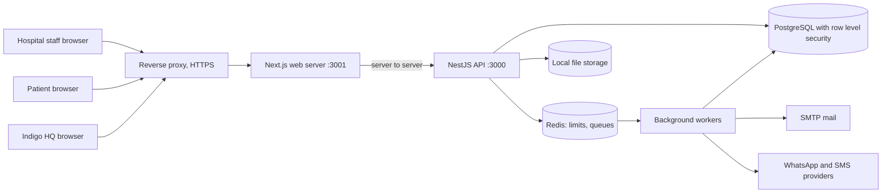
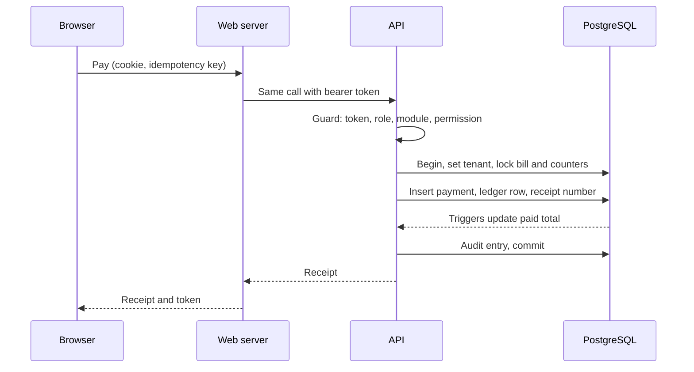

# Hospigo system design (high level)

Status: DRAFT v1 for review, 14 Nov 2026. Author: Rakshith. Covers the system as built in Phase 1 plus the OPD block (see `use-cases-opd.md` and `schema-opd.md`).

**Everything marked ASSUMPTION or PROPOSED is a number or choice made by the developer for discussion. It becomes a target only after management confirms it.**

---

## 1. Goals and constraints

| Item         | Decision on record                                                                      |
| ------------ | --------------------------------------------------------------------------------------- |
| Product      | Multi-tenant hospital SaaS: one codebase, hospital = tenant, branches inside a hospital |
| Style        | Modular monolith, API first, no microservices                                           |
| Users        | Indigo HQ, hospital staff (by branch Access Code), patients (mobile number + OTP)       |
| Connectivity | Online only (no offline mode), web first, mobile app later                              |
| Locale       | English only, India only, times shown in IST                                            |
| Hosting      | Indigo's own servers; Windows for now (Windows or Linux still open)                     |
| Storage      | Local folder behind a StorageService (S3-compatible later)                              |
| First live   | Starts empty: no demo or test data in production                                        |
| Money        | Integer paise, one ledger, nothing edited or deleted, corrections are reversals         |

## 2. System context

The browser talks only to the Next.js server. Tokens live in httpOnly cookies and never reach page scripts. The API is not exposed to browsers directly.

## 3. Components

| Component                    | Responsibility                                 | Notes                                                                                                          |
| ---------------------------- | ---------------------------------------------- | -------------------------------------------------------------------------------------------------------------- |
| Reverse proxy (IIS or nginx) | HTTPS, forwards client IP, routes to web       | Trusted-proxy settings must match (`AUTH_TRUSTED_PROXY`, `WEB_TRUST_FORWARDED_HEADERS`) or per-IP limits break |
| Next.js web (BFF)            | Pages, cookies, calls the API                  | Staff, HQ and patient sessions use separate cookies                                                            |
| NestJS API                   | Business rules, auth, tenant context           | Global deny-by-default guard; OpenAPI via Swagger                                                              |
| PostgreSQL                   | All business data, row level security          | Five logins: owner, app, hq, patient, security (least privilege)                                               |
| Redis (Memurai on Windows)   | Rate limits, lockouts, queue storage           | If Redis is down, login is refused (fail closed)                                                               |
| Background workers (BullMQ)  | Email now; messages, imports and reports later | Retries with backoff                                                                                           |
| File storage                 | Uploaded files, generated documents            | Local folder now                                                                                               |
| Mail and message providers   | Activation, reset, OTP                         | Dev drivers only until go-live                                                                                 |

## 4. Main request flow: take a payment (example)

If the same request arrives twice, the idempotency key returns the first result and nothing is charged again.

## 5. Tenant isolation and security layers

| Layer    | Protection                                                                                                                           |
| -------- | ------------------------------------------------------------------------------------------------------------------------------------ |
| Database | Row level security forced on every tenant table; the app login cannot bypass it; HQ and patient logins see only their own tables     |
| API      | Deny by default; a module must be enabled by Indigo and the role must hold the permission; three token kinds with separate keys      |
| Money    | Append-only tables, trigger-maintained totals, idempotency keys, no negative or over-payment                                         |
| Auth     | argon2, rotating refresh tokens with reuse detection, Redis limits and lockout, OTP stored only as HMAC with atomic attempt counting |
| Browser  | httpOnly cookies, Origin checks, generic error messages, no tokens or phone numbers in URLs                                          |
| Audit    | Append-only log; sensitive actions always logged                                                                                     |
| Process  | Pull request plus required CI check on `develop` and `main`; Dependabot; audit report                                                |

OPD adds: the part-payment, Emergency-flag and refund-approval permissions, and the rule that a refund is refused once a consultation has started.

## 6. Capacity estimate (ASSUMPTIONS, to be confirmed)

| Input                           | Assumed value                                          |
| ------------------------------- | ------------------------------------------------------ |
| Hospitals                       | 10                                                     |
| Branches per hospital (average) | 2, so 20 branches                                      |
| OPD visits per branch per day   | 300, so 6,000 visits a day                             |
| Working hours                   | 10 hours; the busiest hour holds 20 percent of the day |
| Concurrent signed-in users      | 200                                                    |

| Derived                | Calculation                                                                                              | Result                      |
| ---------------------- | -------------------------------------------------------------------------------------------------------- | --------------------------- |
| Rows written per visit | about 30 across visit, bills, lines, payments, ledger, vitals, consultation, prescription, orders, audit | about 30                    |
| Rows per day           | 6,000 x 30                                                                                               | about 180,000               |
| Rows per year          | 180,000 x 365                                                                                            | about 66 million            |
| Storage per year       | 66 million rows x about 400 bytes with indexes                                                           | about 25 GB                 |
| Peak visits per hour   | 6,000 x 20 percent                                                                                       | 1,200 (about 0.33 a second) |
| API calls per visit    | search, create, pay, vitals, queue, consult, print                                                       | about 15                    |
| Peak API rate          | 0.33 x 15, plus queue screens refreshing every 10 seconds                                                | about 25 requests a second  |

Conclusion for review: this size fits one PostgreSQL server and one API process with room to spare, so release 1 needs no complex scaling. The biggest tables are audit, vitals and ledger. If real numbers are much higher, see section 9.

## 7. Targets (PROPOSED for management to confirm)

| Area                | Proposed target                                                                                                               | What it needs                                                                                                                                                                                    |
| ------------------- | ----------------------------------------------------------------------------------------------------------------------------- | ------------------------------------------------------------------------------------------------------------------------------------------------------------------------------------------------ |
| Availability        | 99.5 percent during OPD hours (about 3.6 hours a month of allowed downtime if measured on a full month)                       | Health checks, restart on failure, alerts                                                                                                                                                        |
| Response time       | 95 percent of normal calls under 500 ms; patient search under 800 ms; a page ready in under 2 seconds on the hospital network | Indexes from the schema design, no slow queries                                                                                                                                                  |
| Data loss (RPO)     | 15 minutes at most                                                                                                            | **Continuous log archiving of the database. The current plan, a scheduled upload, gives an RPO equal to the backup interval (for example 24 hours for nightly backups).** Management must choose |
| Recovery time (RTO) | 4 hours at most                                                                                                               | A tested restore. The first restore drill sets the real number                                                                                                                                   |
| Money correctness   | Zero duplicate numbers, zero lost or doubled payments                                                                         | The concurrency and idempotency tests in `schema-opd.md`                                                                                                                                         |
| Security            | No cross-hospital data access, ever                                                                                           | The leak tests stay in CI                                                                                                                                                                        |

## 8. Failure modes

| What fails                                     | What the user sees                                  | What happens                                                                                                             |
| ---------------------------------------------- | --------------------------------------------------- | ------------------------------------------------------------------------------------------------------------------------ |
| Redis down                                     | Login and OTP return "temporarily unavailable"      | Fail closed by design; logged; queued jobs wait                                                                          |
| Database down                                  | Every screen shows a friendly unavailable message   | Health check fails and alerts; no partial writes (transactions)                                                          |
| API process crash                              | Web shows unavailable                               | Process manager restarts it; in-flight money requests are safe because of idempotency keys                               |
| Web server crash                               | Site unavailable                                    | Restart; sessions survive (cookies)                                                                                      |
| Mail provider down                             | Activation or reset email delayed                   | Job retries with backoff                                                                                                 |
| Message provider down (OTP)                    | Patient cannot receive a code                       | Fallback channel once real providers exist; staff login unaffected                                                       |
| Disk full                                      | Uploads and generated files fail                    | Disk usage alert at 80 percent                                                                                           |
| Hospital loses internet                        | The hospital cannot work (online only, by decision) | **Business risk:** needs a paper downtime procedure and a second internet line; back-entry is not supported in release 1 |
| Two web servers refresh the same token at once | A patient or staff member may be signed out         | Known follow-up: add a short grace window before running more than one web server                                        |
| Slow or stuck request                          | Error after the timeout                             | Timeouts exist on patient calls; staff calls to be added                                                                 |

## 9. Scaling path (in order, only when measurements justify it)

1. Tune queries and indexes; keep the connection pool sized to the database.
2. Move the database to its own server (recommended even for go-live, see section 10).
3. Add a second API process behind the proxy (needs the refresh grace window and shared Redis, already shared).
4. Run background workers as a separate process.
5. A read replica for reports.
6. Partition the biggest tables (audit, vitals, ledger) by date.
7. Move file storage to an S3-compatible service.

## 10. Deployment and operations (PROPOSED)

| Topic        | Proposal                                                                                                                               |
| ------------ | -------------------------------------------------------------------------------------------------------------------------------------- |
| Servers      | One application server (proxy, web, API, workers, Redis) and one database server. A single server is acceptable for a first pilot only |
| Environments | Local, staging (a copy of live with its own database, used for the final check before every release) and production                    |
| Releases     | Pull request, green CI, merge to `develop`, release pull request to `main`, tag; staging check before production                       |
| Rollback     | Redeploy the previous tag. Database changes are additive where possible; a destructive migration needs a written rollback plan         |
| Backups      | Nightly full backup plus log archiving, uploaded to the FTP target; a **restore drill before go-live** and after any change            |
| Logging      | Structured logs with a request id, tenant id and user id; never patient details, tokens or phone numbers                               |
| Monitoring   | `/health` uptime check, error tracking, and metrics: requests, latency, error rate, queue depth, disk                                  |
| Alerts       | API or database or Redis down, disk above 80 percent, backup failed, error rate spike, queue backlog, and on-call contact              |
| Runbook      | Short step-by-step guides for the top ten problems, kept in the repo                                                                   |

## 11. API conventions (PROPOSED)

- Version prefix `/v1` on every route; OpenAPI generated by Swagger (already set up) and exported to Postman.
- One error shape for every failure, with a stable code and a generic message.
- Every list is paginated with a capped page size.
- Every money-changing endpoint requires an `Idempotency-Key`.
- Times in ISO format with offset; rule dates (visit date, token date) come from the hospital time zone.

## 12. Open items

| #   | Item                                                                          | Owner      |
| --- | ----------------------------------------------------------------------------- | ---------- |
| 1   | Confirm the capacity assumptions (hospitals, branches, visits per day)        | Management |
| 2   | Choose the data-loss target and whether to archive database logs continuously | Management |
| 3   | Windows or Linux servers; one or two servers for go-live                      | Management |
| 4   | WhatsApp and SMS provider, DLT registration, who pays                         | Management |
| 5   | Domain layout and certificate renewal process                                 | Management |
| 6   | DPDP: Aadhaar storage, referral consent, data retention                       | Management |
| 7   | A paper downtime procedure and second internet line for hospitals             | Hospitals  |
| 8   | Refresh grace window before running more than one web server                  | Developer  |
